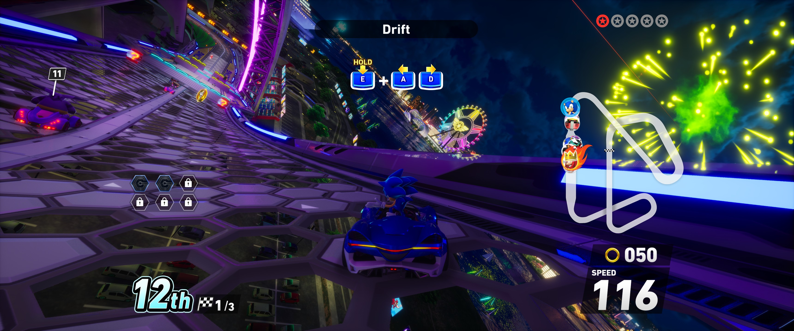

# CrossWorldsFix
 

**CrossWorldsFix** is an ASI plugin for **Sonic Racing: CrossWorlds** that adds ultrawide/narrower support.

## Features

### Ultrawide/Narrower
- Support for ultrawide/narrower aspect ratios.
- Fix HUD issues (like offset markers).
- Span racing HUD.

## Installation  
- Download the latest [release](../../../releases). 
- Extract the contents of the release zip in to the game's binaries folder. (e.g. "**steamapps\common\SonicRacingCrossWorlds\UNION\Binaries\Win64**" for Steam)

### Steam Deck/Linux Additional Instructions
🚩**You do not need to do this if you are using Windows!**  
- Open up the game properties in your launcher and add `WINEDLLOVERRIDES="winmm=n,b" %command%` to the launch options.

## Configuration
- Open **`CrossWorldsFix.ini`** to adjust settings.

## Screenshots
|  |
|:--------------------------:|
| 21:9 Gameplay |

## Credits
Special thanks to **Volf** for making this fix happen!  
[Ultimate ASI Loader](https://github.com/ThirteenAG/Ultimate-ASI-Loader) for ASI loading.  
[inipp](https://github.com/mcmtroffaes/inipp) for ini reading.  
[spdlog](https://github.com/gabime/spdlog) for logging.  
[safetyhook](https://github.com/cursey/safetyhook) for hooking.  
[Dumper-7](https://github.com/Encryqed/Dumper-7) for dumping the SDK.
