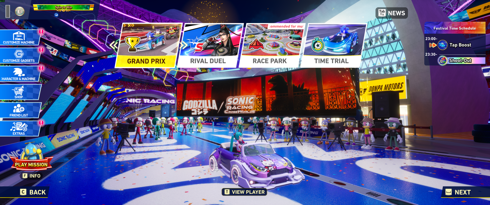
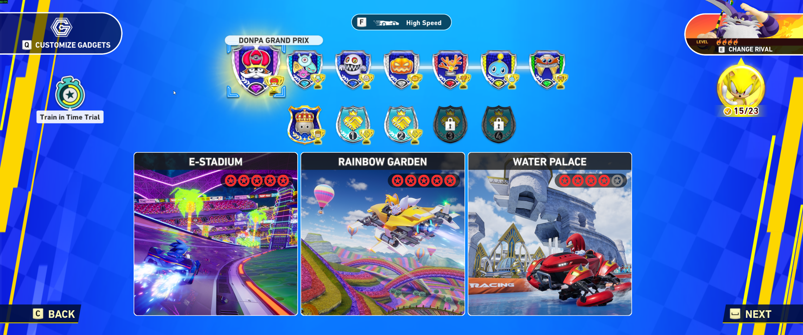
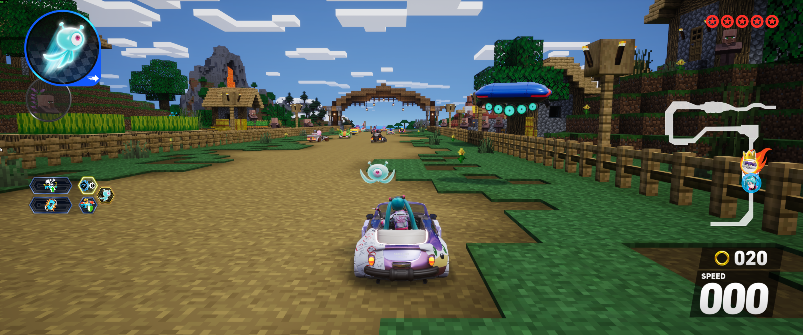

# CrossWorldsFix for Steam 2.0.0

**CrossWorldsFix was created by Lyall.** This unofficial compatibility fork is based on [Lyall’s original CrossWorldsFix on Codeberg](https://codeberg.org/Lyall/CrossWorldsFix). The original project and its contributors deserve credit for the mod. See [LICENSE](LICENSE) for Lyall’s copyright and MIT license.

This fork addresses a race-entry crash on the Windows Steam 2.0.0 build. It looks up the race HUD’s Blueprint widgets by name so changes to their memory offsets no longer break the pause-menu and HUD adjustments. Race entry was verified in-game on Windows Steam 2.0.0.

The Patreon and Ko-fi links below support **Lyall, the original developer of CrossWorldsFix**.

 

**CrossWorldsFix** is an ASI plugin for **Sonic Racing: CrossWorlds** that adds ultrawide/narrower support.

## Choose a build

| Build | What it includes |
| --- | --- |
| [Steam 2.0.0 compatibility fix](../../releases/tag/steam-2.0.0-fix.1) | Fixes the race-entry crash and retains the original ultrawide and narrower-aspect-ratio options. Racing HUD spanning is available and defaults to off. |
| [Experimental menu and HUD layout](../../releases/tag/steam-2.0.0-layout-exp.1) | Includes the compatibility fix and enables single-player racing HUD spanning and menu spanning by default. It moves selected menu controls toward the edges, scales character and course selection artwork proportionally, and corrects the popup offset when menu spanning is enabled. |

The experimental build was tried on an ultrawide display with Windows Steam 2.0.0. Some screens and effects may still use 16:9, and proportionally scaled artwork may crop vertically. The title effects keep their game-authored layout.

## Install on Windows (Steam)

1. Close the game and download the ZIP from the build you chose above.
2. In Steam, right-click **Sonic Racing: CrossWorlds**, then choose **Manage → Browse local files**. Open `UNION\Binaries\Win64`.
3. For a fresh install, copy `CrossWorldsFix.asi`, `CrossWorldsFix.ini`, and `winmm.dll` from the ZIP into that folder.
4. If the mod is already installed, back up your existing files and replace `CrossWorldsFix.asi`. Keep your existing INI to retain your settings. To match the experimental screenshots, set `Enabled = true` under both `[Span Menus]` and `[Span Racing HUD]`. Add the `[Span Menus]` section if your INI predates this build.
5. Launch the game. To switch back, close it and replace the ASI with the one from the compatibility ZIP.

### Steam Deck and Linux

The original mod uses `WINEDLLOVERRIDES="winmm=n,b" %command%` in Steam’s launch options under Proton. The experimental layout was tested on Windows.

## Experimental layout screenshots

**Main menu**

**Course selection**

**Single-player racing HUD**

## Credits
**Lyall** created [CrossWorldsFix](https://codeberg.org/Lyall/CrossWorldsFix) and credits **Volf** for helping make it happen.  
[Ultimate ASI Loader](https://github.com/ThirteenAG/Ultimate-ASI-Loader) for ASI loading.  
[inipp](https://github.com/mcmtroffaes/inipp) for ini reading.  
[spdlog](https://github.com/gabime/spdlog) for logging.  
[safetyhook](https://github.com/cursey/safetyhook) for hooking.  
[Dumper-7](https://github.com/Encryqed/Dumper-7) for dumping the SDK.
